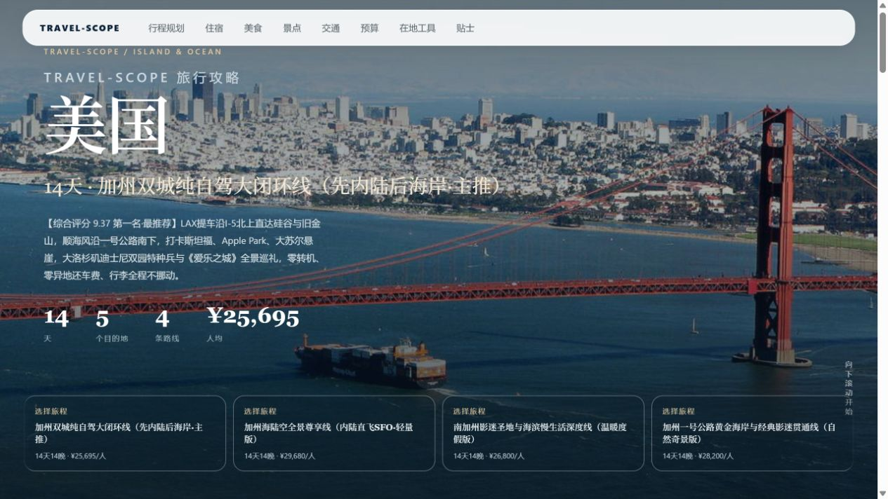
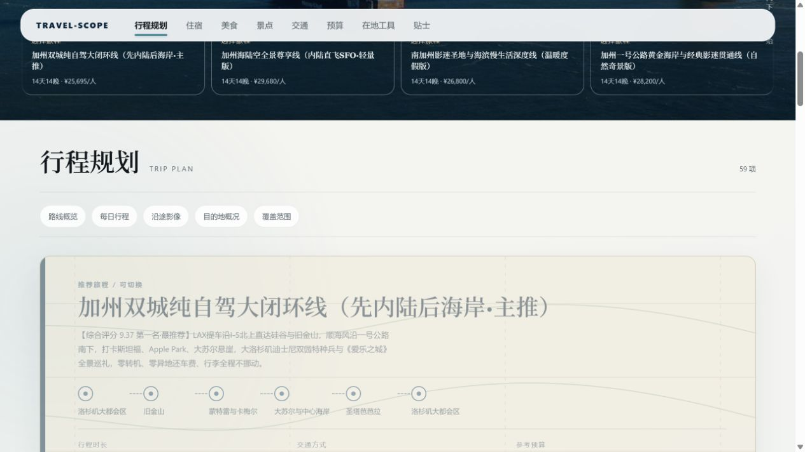
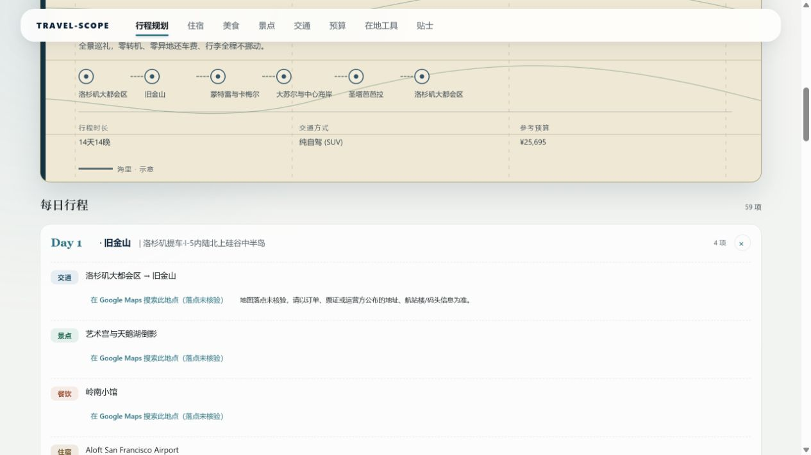
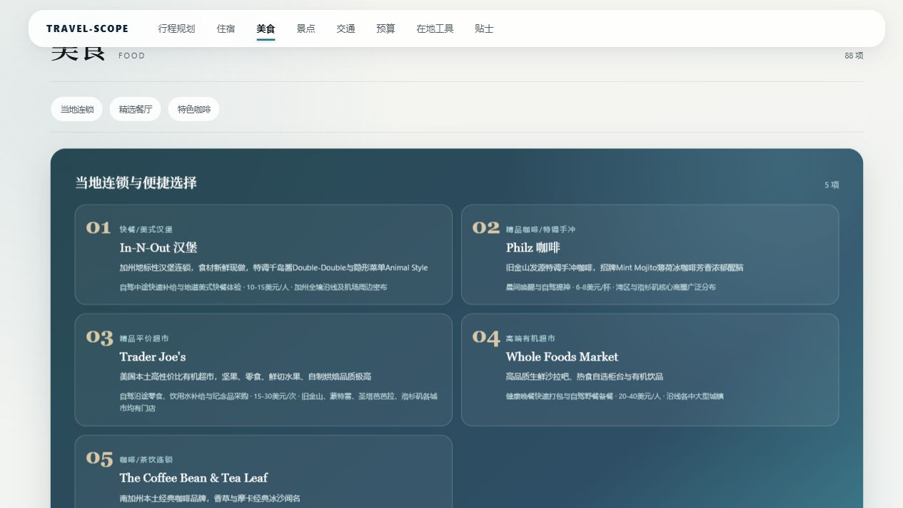
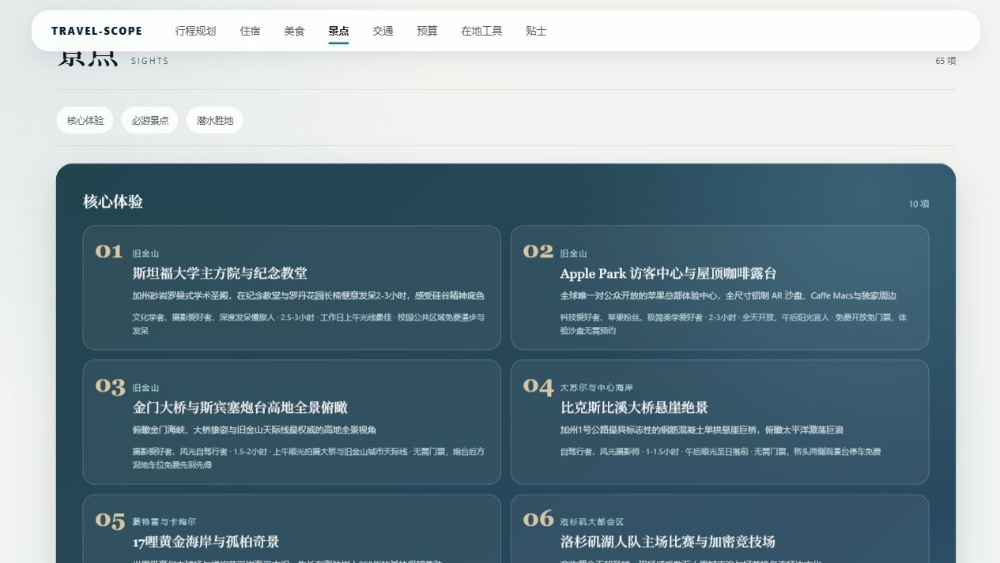
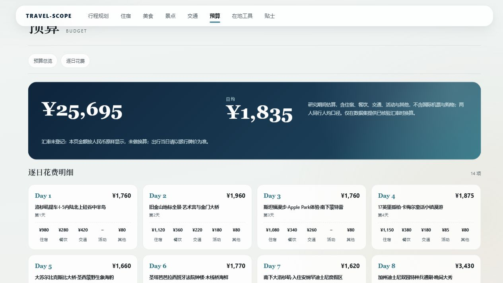
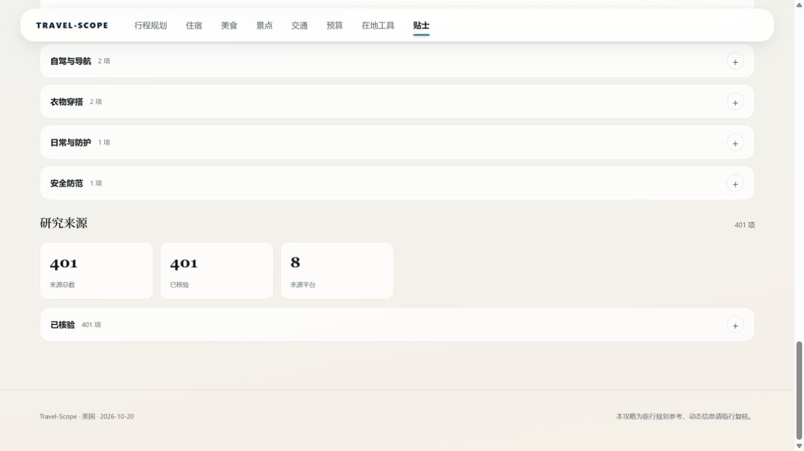
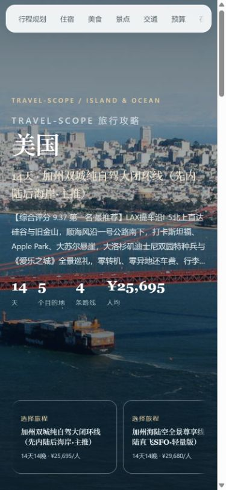
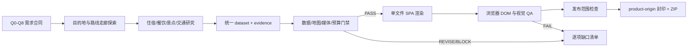

# Travel-Scope v5.0.0

[English](README_EN.md) · [下载 v5.0.0](https://github.com/RoyYang-CN/travel-scope/releases/tag/v5.0.0) · [查看 California 正式案例](https://github.com/RoyYang-CN/travel-scope/releases/download/v5.0.0/travel-scope-v5.0.0-california-zh-formal.html)

[](https://github.com/RoyYang-CN/travel-scope/actions/workflows/quality.yml)
[](https://github.com/RoyYang-CN/travel-scope/releases/tag/v5.0.0)
[](LICENSE)

Travel-Scope 是一个**证据感知的旅行研究、核验与单文件攻略生成系统**。它不是简单地让模型写一篇游记，而是把需求访谈、路线探索、住宿/餐饮/景点/交通研究、地图链接降级策略、媒体来源血缘、预算口径、浏览器视觉 QA 和发布封印串成一条可审计的交付链。

当前公开版本是 **v5.0.0 LIMITED-SCOPE RELEASE**：California 中文正式读者版已经完成端到端验证和业主签署；英文正式交付延期；Philippines 仍处于 `AUDIT_HOLD`，不属于本次发布范围；`production_certified=false`。



## 为什么做 Travel-Scope

常见的 AI 旅行攻略有几个长期问题：

- 信息看起来丰富，但无法追溯它来自哪里、何时核验；
- 地图按钮能打开，却未必落到正确实体；
- 图片来源、许可证、原始字节和最终裁切之间缺少血缘；
- 汇率、预算和价格很容易被固定值或过期数据悄悄填充；
- 一份页面在开发机上可用，换目录、断网或重新构建就失效；
- 单元测试通过常被误写成“攻略整体可用”。

Travel-Scope 的目标是把这些不确定性直接暴露在产品和门禁中：**能够证明的才升级状态，不能证明的就明确降级或阻断，不使用“成功形状”掩盖缺口。**

## 已验证案例：California 14 天中文正式攻略

v5.0.0 附带一份真实的、已签署的 California 中文单文件 SPA。它可以直接在浏览器打开，不依赖服务器，也不需要 Google Places API Key 或 Google Billing。

| 现场指标 | California 案例 |
| --- | ---: |
| 行程时长 | 14 天 14 晚 |
| 目的地 | 5 个 |
| 候选路线 | 4 条 |
| 主推路线研究期参考预算 | ¥25,695 / 人 |
| 每日行程条目 | 59 项 |
| 住宿面 | 36 项 |
| 餐饮面 | 88 项 |
| 景点面 | 65 项 |
| 研究来源 | 401 条 / 8 个平台 |
| 正式 HTML | 3,536,450 bytes |
| HTML SHA-256 | `55A83704B6A06FB6B8D0539EC0C7EDAC31FB2E2AB69540E49FBA27F56206DE1F` |

> 预算是研究期间的规划估算，不是实时可购买报价。数据没有可靠汇率时，系统保持来源币种或标记“汇率未核验”，不会用固定汇率兜底。

### 从路线选择到逐日执行

页面把路线总览、每日行程、沿途影像、目的地概况和覆盖范围放在同一份读者面中。候选路线可以切换，但正式结论仍由数据合同与门禁决定。



逐日模块保留交通、景点、餐饮和住宿的上下文。地图按钮采用诚实状态：当前数据只能支持 `NAMED_SEARCH` 时，页面会明确显示“落点未核验”，不会把名称搜索包装成唯一实体卡命中。



### 住宿、餐饮与景点研究

| 住宿候选与价格口径 | 餐饮、便利选择与咖啡 |
| --- | --- |
|  |  |

住宿和 POI 以文字与证据为主。没有合格图片时，系统允许登记“无图状态”，但不生成伪图片或空白占位资产。价格说明保留来源时间和币种边界，用户仍需在下单前复核库存、税费与取消政策。

| 核心景点与体验 | 逐日预算拆分 |
| --- | --- |
|  |  |

### 来源台账不是装饰

California 正式读者面投影了 401 条研究来源，并展示来源总数、核验状态和平台数量。正式构建前，来源投影、媒体清单、数据集、DOM 和发布报告需要按同一口径对账。

| 研究来源台账 | 移动端响应式页面 |
| --- | --- |
|  |  |

## 核心设计

### 1. 对话式 Q0–Q8 需求合同

一次性收集目的地、日期/月份、天数、预算与住宿档次、自驾/非自驾、到达口岸、研究深度和特殊偏好。已知答案可以直接填入，但缺失字段不会被静默猜测。

### 2. 先探索路线，再扩展 POI

系统先做目的地与走廊探索，再研究住宿、餐饮、咖啡、景点、交通节点和在地工具，避免先堆大量 POI、最后才发现路线不可行。

### 3. 地图链接四态

- `PUBLISHER_ENTITY_LINK`：有合格发布方实体页证据；
- `NAMED_SEARCH`：具名搜索候选，必须提示落点未核验；
- `COORDINATE`：只用于真正无名的坐标地标；
- `NONE`：当前证据不足，不生成按钮。

本项目不调用付费 Google Places API、不要求 Google API Key、不抓取 Google Maps 页面、不合成 Place ID，也不保证每个按钮都会打开唯一 Google 实体卡。

### 4. 媒体三段血缘

正式媒体行需要能解释：

1. 来源修订身份；
2. 实际采集字节；
3. 从采集字节到 prepared/delivered 文件的派生链。

媒体还要通过许可证、MIME、几何下限、单图/总内联预算、run 相对路径、断网重放和两次确定性构建检查。

### 5. 可移植的单文件交付

读者 HTML 内联样式、脚本和已批准媒体。正式 run 使用相对 POSIX 路径，换目录后仍可离线重放。页面同时提供桌面和移动端布局。

### 6. 分层验收，不把组件 PASS 外推成产品 PASS

Travel-Scope 分开记录组件验证、集成验证、正式 run 验证、浏览器 DOM/视觉验证、核心业务结果验证，以及发布范围与业主签署。低层测试通过不能自动升级为 `production-certified`。

## 工作流



## 仓库结构

```text
travel-scope/
├─ SKILL.md                         # 智能体工作合同
├─ VERSION.md                       # 版本历史与撤回声明
├─ product-origin.json              # 文件级 SHA-256 封印
├─ references/                      # 配置驱动的业务合同与策略
│  ├─ release-scope.json
│  ├─ data-model.json
│  ├─ map-link-selection.json
│  ├─ media-policy.json
│  └─ renderer-contract.json
├─ scripts/                         # 初始化、研究、渲染、门禁与测试
├─ assets/                          # SPA 运行时与已登记主题素材
└─ fixtures/                        # 仅用于测试/结构示例的夹具
```

## 快速开始

### 1. 克隆并验证源码封印

```powershell
git clone https://github.com/RoyYang-CN/travel-scope.git
cd travel-scope\travel-scope
python -B scripts/verify_product.py
python -B scripts/test_v500_release_package.py
```

验证成功说明 checkout 与 `product-origin.json` 一致；它不等于新目的地的研究内容已经通过正式门禁。

### 2. 初始化一个 run

```powershell
python -B scripts/init_run.py `
  --country california `
  --run-id travel_scope_run_california_001 `
  --artifact-slug california `
  --delivery-profile reader `
  --runs-dir .temp/runs
```

`artifact_slug` 必须是明确的英文 slug；正式生成缺失时会阻断，不会回退为 `travel-guide`。

### 3. 生成读者页

先阅读脚本帮助，并完成 run manifest、dataset、evidence、媒体与前置阶段：

```powershell
python -B scripts/gen_travel_scope.py --help

python -B scripts/gen_travel_scope.py `
  --mode live `
  --data RUN/dataset.json `
  --output-dir RUN/outputs `
  --language both `
  --expected-days 14 `
  --delivery-profile reader `
  --artifact-slug california
```

正式生成还要求 `TRAVEL_SCOPE_FORMAL_RUN` 与 `TRAVEL_SCOPE_RUN_MANIFEST` 指向真实完成的 SOP 记录。不要通过伪造 completed 状态绕过门禁。新目的地必须重新完成全链验证，不能继承 California 的 PASS。

## v5.0.0 发布边界

| 能力 | 状态 |
| --- | --- |
| California `zh-formal` 单文件读者版 | **PASS / 已签署** |
| California 正式 run、媒体、DOM、预算、离线重放 | **PASS** |
| 英文正式交付 | **DEFERRED** |
| Philippines | **AUDIT_HOLD / EXCLUDED** |
| 其他目的地 | **UNVERIFIED，必须重新过门** |
| Google Places API / Billing | **不使用** |
| 整体 `production_certified` | **false** |

机器可读边界位于 [`travel-scope/references/release-scope.json`](travel-scope/references/release-scope.json)。

## 下载与校验

GitHub [v5.0.0 Release](https://github.com/RoyYang-CN/travel-scope/releases/tag/v5.0.0) 提供：

- `travel-scope-v5.0.0-limited-release.zip`
  SHA-256：`194CB0AEFCDA75EE522FCF69C9833860BAE4A6CCA01E09260F9ADB7BC535DF99`
- `travel-scope-v5.0.0-california-zh-formal.html`
  SHA-256：`55A83704B6A06FB6B8D0539EC0C7EDAC31FB2E2AB69540E49FBA27F56206DE1F`

## 参与贡献

欢迎通过 Issue 或 Pull Request 贡献新目的地的数据适配与独立验证、英文正式交付合同与翻译来源、开放数据/官方来源适配器、地图/媒体/预算/DOM 门禁的反例测试，以及可复现的可访问性与移动端改进。

贡献不得通过放宽阈值、填入猜测值、静默跳过失败或伪造 evidence 让门禁变绿。涉及外部素材时，请同时提交来源、许可证和可复算摘要。

## 安全、隐私与许可证

- 不要提交 API Key、令牌、验证码、认证材料或带凭据的 URL；
- 不要提交个人旅行档案、订单、票证或未经脱敏的正式 run；
- 漏洞请按 [`SECURITY.md`](SECURITY.md) 报告；
- 源代码采用 [Apache License 2.0](LICENSE)；
- 随包第三方媒体及许可证见 [`travel-scope/THIRD_PARTY_NOTICES.md`](travel-scope/THIRD_PARTY_NOTICES.md)。

详细智能体工作合同见 [`travel-scope/SKILL.md`](travel-scope/SKILL.md)，版本事实与撤回声明见 [`travel-scope/VERSION.md`](travel-scope/VERSION.md)。
