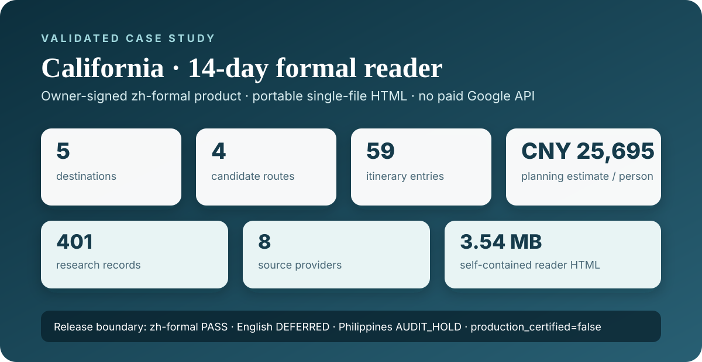
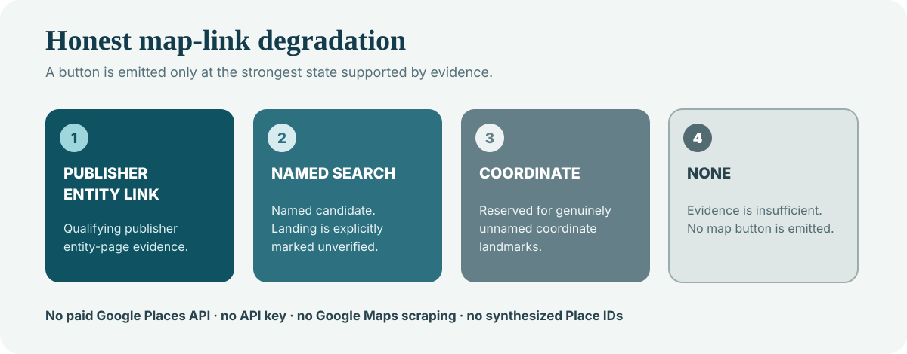
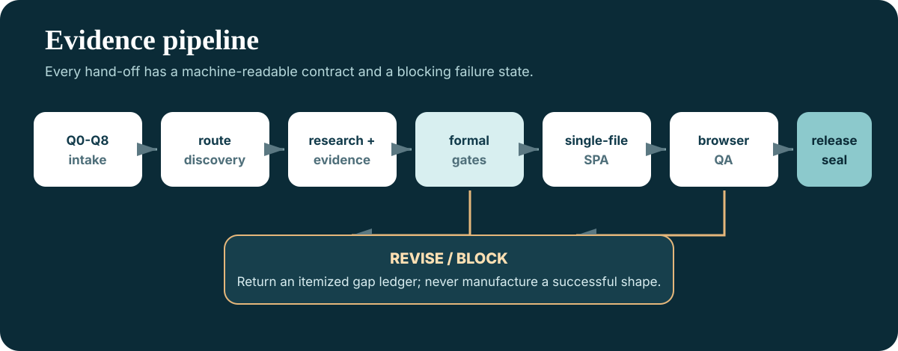
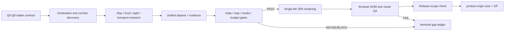

# Travel-Scope v5.0.0

[Chinese documentation](README.md) · [Download v5.0.0](https://github.com/RoyYang-CN/travel-scope/releases/tag/v5.0.0) · [Open the signed California zh-formal reader (Chinese UI)](https://github.com/RoyYang-CN/travel-scope/releases/download/v5.0.0/travel-scope-v5.0.0-california-zh-formal.html)

[](https://github.com/RoyYang-CN/travel-scope/actions/workflows/quality.yml)
[](https://github.com/RoyYang-CN/travel-scope/releases/tag/v5.0.0)
[](LICENSE)

Travel-Scope is an **evidence-aware travel research, validation, and single-file guide generation system**. It does more than ask a model to write an itinerary: it connects conversational intake, route discovery, accommodation/food/sight/transport research, honest map-link degradation, media lineage, budget semantics, browser QA, and a cryptographic release seal.

The public **v5.0.0 LIMITED-SCOPE RELEASE** validates one product surface: the California Chinese formal reader. Formal English delivery is deferred. The Philippines remains on `AUDIT_HOLD` and is excluded. The project does not claim global `production_certified` status.



## Why Travel-Scope exists

AI-generated travel guides often look complete while hiding important uncertainty:

- claims have no reproducible source or verification date;
- a map button opens, but not necessarily on the intended entity;
- media lacks a chain from license and upstream revision to delivered bytes;
- prices and exchange rates are silently filled with stale or fixed defaults;
- a page works on one machine but breaks after relocation or offline replay;
- passing unit tests is presented as proof that the whole guide is usable.

Travel-Scope makes those boundaries explicit. **A state is upgraded only when evidence supports it; otherwise the system degrades honestly or blocks delivery.**

## Validated case study: a 14-day California guide

v5.0.0 includes a signed California Chinese single-file SPA. It opens directly in a browser, requires no application server, and has no Google Places API key or Google Billing dependency. The signed product UI is intentionally Chinese because formal English delivery is still deferred; this English document therefore uses English evidence diagrams rather than presenting translated screenshots as a certified English product.

| Measured reader surface | California case |
| --- | ---: |
| Duration | 14 days / 14 nights |
| Destinations | 5 |
| Candidate routes | 4 |
| Research-time reference budget | CNY 25,695 per person |
| Daily itinerary entries | 59 |
| Stay surface | 36 entries |
| Food surface | 88 entries |
| Sight surface | 65 entries |
| Research ledger | 401 records / 8 providers |
| Formal HTML | 3,536,450 bytes |
| HTML SHA-256 | `55A83704B6A06FB6B8D0539EC0C7EDAC31FB2E2AB69540E49FBA27F56206DE1F` |

> The budget is a planning estimate captured during research, not a live purchasable quote. When a reliable exchange rate is unavailable, the system preserves the source currency or marks the rate unverified instead of applying a fixed fallback.

### What the signed reader contains

The reader combines route comparison, daily itinerary, editorial media, destination context, stay candidates, food and café research, sights, transport, daily budgets, local utilities, practical notes, and a 401-record source ledger in one portable file.

Daily cards preserve transport, sight, food, and stay context. When evidence supports only a named search, the product marks the landing as unverified instead of advertising an exact entity-card match. When no compliant image exists, it records an explicit no-photo state rather than generating a fake image or an empty asset.

The source projection, media manifest, dataset, rendered DOM, and gate reports must reconcile under the same measurement rules. Price notes retain source-time and currency boundaries; inventory, taxes, fees, and cancellation rules still require a booking-time recheck.

The actual signed `zh-formal` UI remains available through the product link above and through the Chinese documentation. It is not reused here as evidence of an English UI.

## Core design

### 1. One conversational Q0–Q8 intake contract

The intake captures destination, dates or month, trip length, budget/accommodation tier, driving preference, arrival gateway, research depth, and special preferences in one batch. Known answers may be pre-filled; missing business inputs are not silently invented.

### 2. Discover routes before expanding POIs

Travel-Scope explores destinations and route corridors before expanding hotels, restaurants, cafés, sights, transport nodes, and local utilities. This avoids building a large POI list around an itinerary that is structurally infeasible.

### 3. Four map-link states

- `PUBLISHER_ENTITY_LINK`: supported by qualifying publisher entity-page evidence;
- `NAMED_SEARCH`: a named search candidate with an explicit unverified-landing notice;
- `COORDINATE`: reserved for genuinely unnamed coordinate landmarks;
- `NONE`: insufficient evidence, so no button is emitted.

The released workflow does not call paid Google Places APIs, require a Google API key, scrape Google Maps pages, synthesize Place IDs, or promise that every link opens a unique Google entity card.



### 4. Three-part media lineage

Each formal media row must explain upstream revision identity, acquired bytes, and the derivation chain from acquisition to prepared and delivered assets. Media is also checked for license, MIME, geometry floor, per-image and total inline budgets, run-relative paths, offline replay, and deterministic rebuilds.

### 5. Portable single-file delivery

The reader inlines approved styles, scripts, and media. Formal runs use relative POSIX paths and can be replayed after relocation. The same product supports desktop and mobile layouts.

### 6. Layered acceptance

Travel-Scope reports component, integration, formal-run, browser DOM/visual, business-result, and release-scope verification separately. A lower-level PASS does not automatically become `production-certified`.

## Workflow





## Repository layout

```text
travel-scope/
├─ SKILL.md                         # agent workflow contract
├─ VERSION.md                       # release history and withdrawn claims
├─ product-origin.json              # file-level SHA-256 seal
├─ references/                      # configuration-driven product contracts
│  ├─ release-scope.json
│  ├─ data-model.json
│  ├─ map-link-selection.json
│  ├─ media-policy.json
│  └─ renderer-contract.json
├─ scripts/                         # initialization, rendering, gates, and tests
├─ assets/                          # SPA runtime and registered theme media
└─ fixtures/                        # test/schema fixtures only
```

## Quick start

### 1. Clone and verify the source seal

```powershell
git clone https://github.com/RoyYang-CN/travel-scope.git
cd travel-scope\travel-scope
python -B scripts/verify_product.py
python -B scripts/test_v500_release_package.py
```

A successful check proves that the checkout matches `product-origin.json`. It does not certify the research content of a new destination.

### 2. Initialize a run

```powershell
python -B scripts/init_run.py `
  --country california `
  --run-id travel_scope_run_california_001 `
  --artifact-slug california `
  --delivery-profile reader `
  --runs-dir .temp/runs
```

`artifact_slug` must be an explicit English slug. Formal generation blocks a missing value instead of falling back to a generic `travel-guide` name.

### 3. Build a reader

Read the script help first and complete the manifest, dataset, evidence, media, and prerequisite stages:

```powershell
python -B scripts/gen_travel_scope.py --help

python -B scripts/gen_travel_scope.py `
  --mode live `
  --data RUN/dataset.json `
  --output-dir RUN/outputs `
  --language both `
  --expected-days 14 `
  --delivery-profile reader `
  --artifact-slug california
```

Formal generation also requires `TRAVEL_SCOPE_FORMAL_RUN` and `TRAVEL_SCOPE_RUN_MANIFEST` to point to genuinely completed SOP evidence. Do not fabricate completed stages to bypass gates. Every new destination must pass the full chain independently; it does not inherit California's PASS.

## v5.0.0 release boundary

| Capability | Status |
| --- | --- |
| California `zh-formal` single-file reader | **PASS / owner-signed** |
| California formal run, media, DOM, budget, offline replay | **PASS** |
| Formal English delivery | **DEFERRED** |
| Philippines | **AUDIT_HOLD / EXCLUDED** |
| Other destinations | **UNVERIFIED; independent gates required** |
| Google Places API / Billing | **Not used** |
| Overall `production_certified` | **false** |

The machine-readable boundary is [`travel-scope/references/release-scope.json`](travel-scope/references/release-scope.json).

## Downloads and checksums

The GitHub [v5.0.0 release](https://github.com/RoyYang-CN/travel-scope/releases/tag/v5.0.0) provides:

- `travel-scope-v5.0.0-limited-release.zip`
  SHA-256: `194CB0AEFCDA75EE522FCF69C9833860BAE4A6CCA01E09260F9ADB7BC535DF99`
- `travel-scope-v5.0.0-california-zh-formal.html`
  SHA-256: `55A83704B6A06FB6B8D0539EC0C7EDAC31FB2E2AB69540E49FBA27F56206DE1F`

## Contributing

Issues and pull requests are welcome for independent destination adapters and evidence, formal English delivery, open/official-source adapters, adversarial gate tests, and reproducible accessibility or mobile improvements.

Contributions must not turn gates green by weakening thresholds, inserting guessed values, silently skipping failures, or fabricating evidence. External media contributions must include source, license, and reproducible digests.

## Security, privacy, and license

- Do not commit API keys, tokens, OTPs, authentication material, or credential-bearing URLs.
- Do not commit personal trip records, bookings, tickets, or unsanitized formal runs.
- Report vulnerabilities through [`SECURITY.md`](SECURITY.md).
- Source code is licensed under [Apache License 2.0](LICENSE).
- Bundled third-party media and licenses are documented in [`travel-scope/THIRD_PARTY_NOTICES.md`](travel-scope/THIRD_PARTY_NOTICES.md).

See [`travel-scope/SKILL.md`](travel-scope/SKILL.md) for the agent workflow contract and [`travel-scope/VERSION.md`](travel-scope/VERSION.md) for release facts and withdrawn claims.
